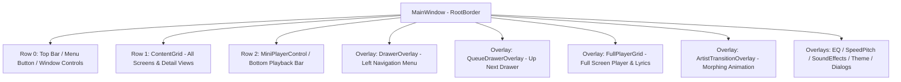
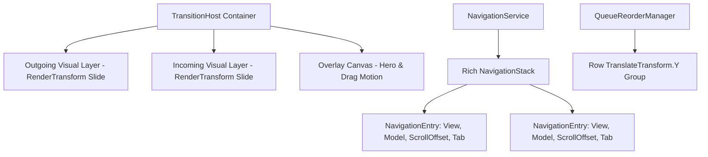

# NAVIGATION ARCHITECTURE AUDIT & FLUID TRANSITION PROPOSAL
**Document Version:** 1.0.0  
**Target Application:** MusicPlayer (.NET 8 WPF, Windows 10/11)  
**Scope:** Read-Only Architectural Audit & Navigation Redesign Proposal  
**Classification:** PHASE 1 — RESEARCH & ARCHITECTURE DESIGN ONLY  

---

## EXECUTIVE SUMMARY

This audit provides an exhaustive examination of the navigation, view lifecycle, state management, and motion architecture across the `MusicPlayer` application. It specifically investigates the technical constraints that currently prevent fluid page-sliding transitions and seamless, physics-based reorder motion (**FLIP / neighbor displacement**) within the **Up Next / Play Next Queue**.

### Core Findings
1. **Monolithic Visibility-Based Switching**: All primary application screens (over 35 distinct views) are declared inline inside a single 5,048-line XAML file (`src/MusicPlayer/Views/MainWindow.xaml`), grouped as children of `ContentGrid`. View changes are executed via binary visibility toggles (`Visibility.Collapsed` vs `Visibility.Visible`) driven by `EqualityToVisibilityConverter` bound to `MainViewModel.CurrentView`.
2. **Primitive String-Only BackStack**: Navigation history is tracked using a rudimentary `Stack<string> _viewHistory`. It stores only screen identifiers (e.g., `"albums"`), losing scroll positions, active tab selections, search filters, and page parameters (e.g., which artist or album was opened).
3. **Queue Stationary-Item Reorder Limitation**: During queue drag-and-drop, the dragged row floats as an elevated adorner card on an overlay canvas, but **all neighboring rows remain completely stationary**. Reordering does not physically displace adjacent items in real time. On drop, the item is committed to the underlying `ObservableCollection<MusicTrack>`, causing `VirtualizingStackPanel` to instantaneously pop and shift items in 0ms without intermediate motion.
4. **Viability of Smooth Transitions**: The application already possesses hardware acceleration (Direct3D Tier 2) and cleanly implements GPU transform animations for the Mini/Full Player, the Side Drawer, the Queue Drawer, and the circular Artist Hero morph. Fluid sliding transitions and continuous FLIP queue animations are **entirely feasible** without rewriting the audio engine or discarding the existing MVVM foundation.

---

## 1. CURRENT NAVIGATION ARCHITECTURE

### 1.1 Structural Overview
The entire application UI resides in `src/MusicPlayer/Views/MainWindow.xaml` with code-behind in `src/MusicPlayer/Views/MainWindow.xaml.cs`. The window structure consists of three vertical tiers:



### 1.2 View Switching Mechanism
- **File**: `src/MusicPlayer/Views/MainWindow.xaml` (line 41)
- **Class**: `MainWindow`
- **Mechanism**: Every view is wrapped in a `<Grid>` or `<ScrollViewer>` directly under `ContentGrid`. Each view evaluates:
  ```xml
  Visibility="{Binding CurrentView, Converter={StaticResource EqualityToVisibilityConverter}, ConverterParameter=<view_name>}"
  ```
- **Execution**: When `MainViewModel.CurrentView` changes, WPF runs the converter:
  - The previous view's `Visibility` becomes `Visibility.Collapsed`.
  - The target view's `Visibility` becomes `Visibility.Visible`.
  - In `src/MusicPlayer/Views/MainWindow.xaml.cs` (line 3040), `OnViewModelPropertyChanged` intercepts `CurrentView` change and executes `AnimatePageZoom()`:
    - Target: `ContentGrid` (the parent container of all views).
    - Properties: `ScaleX: 1.03 -> 1.0`, `ScaleY: 1.03 -> 1.0`, `Opacity: 0.6 -> 1.0` (300ms `CubicEase.EaseOut`).
    - Finding: The individual incoming and outgoing pages **do not slide relative to one another**. Instead, the entire viewport jumps to the new page and undergoes a minor whole-screen bounce.

---

## 2. COMPREHENSIVE NAVIGATION MAP

```text
MainWindow
 ├── [Overlay] DrawerOverlay (Left Nav Menu)
 │    ├── "home" ───────────────► Home View
 │    ├── "songs" ──────────────► Library: Tracks Tab
 │    ├── "artists" ────────────► Library: Artists Tab
 │    ├── "albums" ─────────────► Library: Albums Tab
 │    ├── "genres" ─────────────► Library: Genres Tab
 │    ├── "folders" ────────────► Library: Folders Tab
 │    ├── "playlists" ──────────► Playlists Overview
 │    ├── "theme" ──────────────► Theme Gallery
 │    ├── "settings" ───────────► Settings
 │    ├── "hidden_folders" ─────► Hidden Folders Tool
 │    ├── "duplicate_finder" ───► Duplicate Finder Tool
 │    ├── "deleted_music" ──────► Deleted Music Recovery
 │    └── "audio_editor" ───────► Audio Editor Tool
 │
 ├── [Main Views] ContentGrid (Row 1)
 │    ├── "home"
 │    │    ├── Search Box ──────► In-place Search Results
 │    │    ├── Card "Songs" ────► "songs"
 │    │    ├── Card "Artists" ──► "artists"
 │    │    ├── Card "Albums" ───► "albums"
 │    │    ├── Card "Folders" ──► "folders"
 │    │    ├── Card "Favorites" ► "favorites"
 │    │    ├── Card "Recent" ───► "recent"
 │    │    ├── Card "RecentAdd" ► "recent_add"
 │    │    └── Card "MostPlay" ─► "most_played"
 │    │
 │    ├── Library Multi-Tab (TabSlideHost)
 │    │    ├── Tab "songs" ─────► All Songs ListBox
 │    │    ├── Tab "artists" ───► Artists Grid ────► [Hero Click] ──► "artist_detail"
 │    │    ├── Tab "albums" ────► Albums Grid ─────► [Hero Click] ──► "album_detail"
 │    │    ├── Tab "genres" ────► Genres List ─────► [Click] ───────► "genre_detail"
 │    │    └── Tab "folders" ───► Folders List ────► [Click] ───────► "folder_detail"
 │    │
 │    ├── Detail Pages
 │    │    ├── "artist_detail" (ArtistDetailView)
 │    │    │    ├── Sub-Tab "albums" ──► Artist Album Cards ──► "album_detail"
 │    │    └── Sub-Tab "tracks" ──► Artist Songs List
 │    │    ├── "album_detail" (AlbumDetailView) ──► Album Tracks List
 │    │    ├── "genre_detail" (GenreDetailView) ──► Genre Tracks List
 │    │    ├── "folder_detail" (FolderDetailView) ─► Folder Tracks List
 │    │    └── "playlist_detail" (PlaylistDetailView) ─► Playlist Tracks List
 │    │
 │    ├── Management & Tool Views
 │    │    ├── "lrc_browser", "lrc_editor", "lyric_list", "status_bar_lyrics"
 │    │    ├── "theme_edit", "sleep_timer", "widget", "lock_screen"
 │    │    └── "edit_tags", "batch_edit", "album_getter", "album_save", "music_set_edit"
 │    │
 ├── [Overlay] QueueDrawerOverlay (Right Drawer: Up Next)
 │    ├── Now Playing Hero Card (Album Art, Title, Equalizer, Play/Pause)
 │    ├── Real-Time Filter Search Box (QueueFilterText)
 │    └── Virtualized Queue ListBox (Drag-and-drop, Swipe-to-remove)
 │
 ├── [Overlay] FullPlayerGrid (Bottom-to-Top Full Screen Modal)
 │    ├── Album Art View / Audio Visualizer
 │    ├── Synchronized Lyrics View (Auto-scrolling, click-to-seek)
 │    └── Equalizer & Sound Effects Modals
 │
 └── [Overlay] ArtistTransitionOverlay (Canvas for Shared-Element Morphing)
```

---

## 3. NAVIGATION ENTRY POINTS AUDIT

| Source View | Target View | Command / Event | Code Reference | State Preserved | Visual Destroyed / Recreated | Animation |
| :--- | :--- | :--- | :--- | :--- | :--- | :--- |
| Any | `home` | `DrawerHome_Click` / `Navigate("home")` | `MainWindow.xaml.cs:2235` | Partial (Data preserved, scroll reset) | No (Visibility toggle) | Whole-screen zoom (300ms) |
| `home` | `songs` | `Card_Click` (`TargetView="songs"`) | `MainViewModel.cs:4538` | Partial | No (Visibility toggle) | Whole-screen zoom (300ms) |
| `home` | `artists` | `Card_Click` (`TargetView="artists"`) | `MainViewModel.cs:4538` | Partial | No (Visibility toggle) | Whole-screen zoom (300ms) |
| `home` | `albums` | `Card_Click` (`TargetView="albums"`) | `MainViewModel.cs:4538` | Partial | No (Visibility toggle) | Whole-screen zoom (300ms) |
| Library Tab A | Library Tab B | `Tab*_Click` (`SwitchTab`) | `MainWindow.xaml.cs:398` | **YES** (Both stay alive in `TabSlideHost`) | No (Kept loaded in host) | **Horizontal Slide** (220ms QuarticEase) |
| `artists` | `artist_detail` | `ArtistCard_Click` | `MainWindow.xaml.cs:670` | **NO** (Previous artist overwritten) | No (Visibility toggle) | **Circle Hero Morph** (350ms CubicEase) |
| `albums` | `album_detail` | `AlbumCard_Click` | `MainWindow.xaml.cs:488` | **NO** (Previous album overwritten) | No (Visibility toggle) | **Square Hero Morph** (350ms CubicEase) |
| `folders` | `folder_detail` | `FolderRow_Click` | `MainWindow.xaml.cs:1240` | **NO** (Path overwritten) | No (Visibility toggle) | Whole-screen zoom (300ms) |
| `genres` | `genre_detail` | `GenreRow_Click` | `MainWindow.xaml.cs:527` | **NO** (Genre overwritten) | No (Visibility toggle) | Whole-screen zoom (300ms) |
| `playlists` | `playlist_detail`| `PlaylistCard_Click` | `MainWindow.xaml.cs:2000` | **NO** (Playlist overwritten) | No (Visibility toggle) | Whole-screen zoom (300ms) |
| Any | `Up Next` Drawer | `ToggleQueueCommand` | `MainWindow.xaml.cs:2225` | **YES** (Drawer preserves collection) | No (Overlay TranslateTransform) | **Slide Right-to-Left** (300ms CubicEase) |
| MiniPlayer | `Full Player` | `MiniPlayer_Click` | `MainWindow.xaml.cs:3066` | **YES** (Underlying view untouched) | No (Overlay TranslateTransform) | **Slide Bottom-to-Top** (380ms CubicEase) |
| Any | Back (`Escape`) | `GoBackCommand` | `MainViewModel.cs:4203` | **NO** (Pops string, discards context) | No (Visibility toggle) | Whole-screen zoom (300ms) |

---

## 4. CURRENT VIEW LIFECYCLE AUDIT

### 4.1 Are Views Destroyed or Recreated?
- **Finding**: **Neither.** Views are declared as static nodes in the visual tree of `MainWindow`.
- **Proof**: All ~35 view grids exist simultaneously as child elements of `ContentGrid`.
- **Mechanism**:
  ```csharp
  // When CurrentView changes:
  // 1. EqualityToVisibilityConverter evaluates on all bound Grids.
  // 2. The departing Grid receives UIElement.Visibility = Visibility.Collapsed.
  // 3. The arriving Grid receives UIElement.Visibility = Visibility.Visible.
  ```

### 4.2 Impact of `Visibility.Collapsed` on WPF Elements
1. **Layout & Measure Passes**: A `Collapsed` element is completely skipped during the parent `MeasureOverride` and `ArrangeOverride`.
2. **Virtualizing Lists (`ListBox`, `VirtualizingStackPanel`)**:
   - When a `ListBox` becomes `Collapsed`, the `VirtualizingStackPanel` cleans up its visual child references.
   - When restored to `Visible`, the panel initiates a fresh measure pass from index 0, generating new item containers.
3. **Animations**: Any active storyboards on the outgoing view are stopped or discarded.

---

## 5. BACK NAVIGATION & STATE PRESERVATION AUDIT

### 5.1 The Current BackStack Architecture
- **Location**: `MainViewModel.cs` (line 4215)
- **Data Structure**:
  ```csharp
  private readonly Stack<string> _viewHistory = new();
  ```
- **Evaluation**: The back stack is **strictly string-based** (`Stack<string>`). It stores raw string identifiers like `"songs"`, `"albums"`, `"artist_detail"`.

### 5.2 What State is Permanently Lost on Navigation?
1. **Scroll Offsets**: Neither `ScrollViewer.VerticalOffset` nor item index is saved. Returning from `AlbumDetail` to `Albums` resets the viewport position on large collections.
2. **Detail Context**:
   - `MainViewModel` has singular scalar properties: `CurrentArtistName`, `CurrentAlbumName`, `CurrentFolderName`.
   - If the user navigates: `Artist A -> Album X -> Artist B -> Back`, `_viewHistory` pops `"artist_detail"`. However, `CurrentArtistName` was already overwritten by `Artist B`. Returning back shows **Artist B instead of Artist A**.
3. **Sub-Tab Selection**:
   - `ArtistDetailActiveTab` (tracks vs albums) is not stored on the stack.
4. **Search / Filter Query**:
   - If a search was active in a view, navigating away and returning clears or desynchronizes the search filter.

---

## 6. TRANSITIONS & TRANSFORM AUDIT

### 6.1 Existing Transitions Matrix

| Component | Trigger | Implementation | Target Property | Duration | Easing |
| :--- | :--- | :--- | :--- | :--- | :--- |
| **All Page Views** | `CurrentView` change | `MainWindow.xaml.cs:3291` | `ContentGrid.ScaleX`, `ScaleY`, `Opacity` | 300ms | `CubicEase.EaseOut` |
| **Library Tabs** | Tab button click | `MainWindow.xaml.cs:436` | `incoming.TranslateTransform.X`, `outgoing.TranslateTransform.X` | 220ms | `QuarticEase.EaseOut` |
| **Queue Drawer** | Open / Close | `MainWindow.xaml.cs:2235` | `QueueDrawerTranslate.X` (430 $\leftrightarrow$ 0), `Backdrop.Opacity` | 300ms / 220ms | `CubicEase.EaseOut / EaseIn` |
| **Full Player** | Open / Close | `MainWindow.xaml.cs:3082` | `FullPlayerGrid.TranslateTransform.Y` (H $\leftrightarrow$ 0), `Opacity` | 380ms / 280ms | `CubicEase.EaseOut / EaseIn` |
| **Left Drawer** | Hamburger menu | `MainWindow.xaml.cs:3338` | `DrawerPanel.TranslateTransform.X` (-300 $\leftrightarrow$ 0), `Backdrop.Opacity` | 300ms / 220ms | `CubicEase.EaseOut` |
| **Artist/Album Hero** | Grid item click | `MainWindow.xaml.cs:921` | `ArtistTransitionScale`, `ArtistTransitionTranslate`, `Clip` | 350ms | `CubicEase.EaseInOut` |

### 6.2 Layout vs Transform Evaluation
- **Finding**: All existing custom animations (`Drawer`, `Queue`, `FullPlayer`, `Hero`, `LibraryTabs`) correctly animate **`RenderTransform` (`TranslateTransform`, `ScaleTransform`) and `Opacity`**.
- **Performance Significance**: Animating `RenderTransform` does not trigger WPF layout recalculations (`Measure` / `Arrange`). It executes on the composition pass and leverages GPU hardware acceleration (Direct3D Tier 2 on Intel HD Graphics).
- **The Gap**: Only the **primary page navigation** (`CurrentView`) lacks transform sliding. It relies on instantaneous `Visibility` toggling followed by a whole-window scale bounce.

---

## 7. PLAY NEXT / QUEUE DRAG & REORDER AUDIT

### 7.1 Architecture of the Up Next Drawer
- **Container**: `QueueDrawerPanel` (right-side drawer, width 430px) inside `QueueDrawerOverlay`.
- **Items Host**: `<ListBox x:Name="QueueListBox" Style="{StaticResource APK_VirtualListBox}" ItemsSource="{Binding Queue}">`
- **Virtualization**:
  ```xml
  VirtualizingPanel.IsVirtualizing="True"
  VirtualizingPanel.VirtualizationMode="Recycling"
  VirtualizingPanel.ScrollUnit="Pixel"
  ```

### 7.2 The Current Drag & Drop Lifecycle
- **Files**: `MainWindow.xaml.cs` (lines 1392-1670), `QueueDragVisual.cs`
- **Lifecycle Flow**:
  1. `PreviewMouseLeftButtonDown`: Records start point, resets swipe transforms, captures mouse on `QueueItemBorder`.
  2. `MouseMove`: If $\Delta Y > 10\text{px}$:
     - `_queueIsDragging = true`.
     - Drag adorner card (`QueueDragVisual`) is instantiated and placed on `QueueDragCanvas`.
     - Source row opacity is set to `0.35` (`SetQueueItemVisibility(track, hidden: true)`).
     - `ShowDropPlaceholder(newIndex)` calculates the target gap and draws a glowing blue indicator line on the canvas.
     - Auto-scroll runs if mouse is near top/bottom edges.
  3. `MouseUp`: Calls `CommitQueueDrag()`:
     - Calculates target gap index.
     - Calls `ViewModel.MoveQueueItem(fromIndex, targetIndex, saveState: true)`.
     - Animates the ghost adorner to the target container position (180ms cubic ease).
     - Releases capture and clears drag flags.
  4. `CancelQueueDrag(reason)`: Fully idempotent cleanup on focus loss, Escape, capture loss, or minimize.

---

## 8. WHY THE CURRENT QUEUE CANNOT YET DO FLUID SLIDING REORDER (FLIP)

### Technical Root Causes:

```text
CURRENT BEHAVIOR:
Item A [Index 0] ──────────► Stationary
Item B [Index 1] ──────────► Stationary
Item C [Index 2] (Dragged) ─► Floats on Canvas | Source row dimmed (0.35)
Item D [Index 3] ──────────► Stationary
[Blue Indicator Line shows gap between A and B]

ON DROP (Commit):
Queue.Move(2, 0)
↓
ListBox receives NotifyCollectionChangedAction.Move
↓
VirtualizingStackPanel instantly reconstructs/re-indexes visible slots in 0ms!
↓
VISUAL JUMP (No slide animation)
```

1. **Stationary Neighbor Items**:
   While item C is dragged over item A, items A and B **do not move**. They do not slide down by 58px to visually open the slot.
2. **Missing Vertical Transform in Row Template**:
   The row template in `MainWindow.xaml` (line 4483) defines:
   ```xml
   <Border.RenderTransform>
       <TranslateTransform x:Name="QueueItemTranslate" X="0" />
   </Border.RenderTransform>
   ```
   This transform only supports $X$-axis movement (for swipe-to-remove). There is **no $Y$-axis translation** to shift neighbor rows up or down!
3. **`VirtualizingStackPanel` Destructive Re-indexing**:
   When `ObservableCollection<MusicTrack>.Move(oldIndex, newIndex)` is called:
   `VirtualizingStackPanel` handles `NotifyCollectionChangedAction.Move` by invalidating its arrange state and instantaneously moving the containers. There is no built-in interpolation.
4. **Decoupling Requirement (Visual Preview vs Data Commit)**:
   To achieve smooth sliding (like Spotify or Apple Music):
   - The underlying `Queue` collection **must NOT move** during the drag.
   - Neighboring visible rows must dynamically receive smooth `TranslateTransform.Y = +58px` or `-58px` as the dragged card enters their slot.
   - When the user drops, the collection commits once, and the transforms reset seamlessly without a flicker.

---

## 9. PROPOSED NAVIGATION ARCHITECTURES

### OPTION A: Layered `TransitionHost` + Persistent Page Instances (RECOMMENDED)



- **Architecture**:
  - Replace the static visibility toggling in `ContentGrid` with a lightweight `TransitionHost`.
  - The `TransitionHost` maintains two viewport slots: `OutgoingPresenter` and `IncomingPresenter`.
  - Views are decoupled into clean, modular UserControls (`SongsView`, `ArtistsView`, `AlbumsView`, `ArtistDetailView`, `AlbumDetailView`, `SettingsView`).
  - A `ViewCache` keeps frequently accessed views alive in memory.
  - A `RichNavigationStack` records not just the string name, but a `NavigationEntry` containing:
    - View Name
    - Parameters (e.g., `ArtistName`, `AlbumId`)
    - Exact `VerticalOffset` of the page's `ScrollViewer`
    - Sub-tab selection and filter text.
- **Queue Animation**:
  - Augment `QueueItemBorder.RenderTransform` with a `TransformGroup` containing both `TranslateTransform.X` (swipe) and `TranslateTransform.Y` (reorder).
  - A `QueueReorderManager` applies continuous spring/cubic easing to neighbor items:
    - When dragged row moves past midpoint of row $k$, row $k$ smoothly animates $Y = \pm 58\text{px}$ over 160ms.
- **Advantages**:
  - Full bidirectional sliding page transitions (Forward = slide left from $+W \to 0$; Back = slide right from $-W \to 0$).
  - Complete state preservation on Back navigation (scroll position, tabs, search restored).
  - Fluid FLIP reordering in Up Next queue with zero collection mutation until drop.
  - 100% compatible with existing `MainViewModel`, `AudioEngine`, and audio playback thread.
- **Trade-offs**: Requires modularizing large inline XAML sections into focused UserControls.

---

### OPTION B: WPF Native `Frame` + Navigation Journal with Page Cache
- **Architecture**:
  - Replace `ContentGrid` with a WPF `<Frame NavigationUIVisibility="Hidden">`.
  - Convert views into WPF `Page` classes.
  - Use `NavigationService.Navigate(pageInstance)`.
  - Custom `PageFunction` or `IProvideCustomContentState` for state persistence.
- **Advantages**: Built-in journal back-stack, native navigation events (`Navigating`, `Navigated`).
- **Disadvantages**:
  - WPF `Frame` has notorious architectural overhead (complex navigation service, security sandboxing, default focus issues).
  - Transition animations between `Page` instances in a `Frame` require complex adorners or visual tree capture hacks.
  - High risk of memory retention if pages hold references to heavy bitmaps.
- **Queue Animation**: Does not solve queue reordering; queue would still need external management.

---

### OPTION C: Full Reactive MVVM-Router with Dynamic ViewModels
- **Architecture**:
  - Decompose `MainViewModel` into isolated child ViewModels (`ArtistDetailViewModel`, `AlbumsViewModel`, `SettingsViewModel`).
  - Use a `CurrentViewModel` property with `<ContentControl Content="{Binding CurrentViewModel}">` and DataTemplates.
  - View lifecycle tied directly to ViewModel instantiation and disposal.
- **Advantages**: Modern enterprise MVVM, completely decoupled business logic.
- **Disadvantages**:
  - **Violates user constraint**: Requires a massive, high-risk rewrite of the entire codebase (over 7,800 lines in `MainViewModel.cs`).
  - High risk of audio playback regressions and synchronization bugs.
  - Destroys view state on disposal unless complex memento patterns are built.

---

## 10. COMPREHENSIVE ARCHITECTURE COMPARISON

| Dimension | Option A: Layered TransitionHost (Recommended) | Option B: WPF Frame & Pages | Option C: Reactive MVVM Router | Current Architecture |
| :--- | :--- | :--- | :--- | :--- |
| **Sliding Page Transitions** | **Excellent** (Hardware accelerated dual-layer slide) | Fair (Requires Frame transition hacks) | Good (Storyboard on ContentControl) | **None** (Instant toggle + whole-window zoom) |
| **Shared-Element Transitions** | **Seamless** (Coordinated overlay canvas) | Difficult (Frame isolates visual trees) | Moderate | Basic (Manual Canvas Overlay) |
| **Queue Fluid Reorder (FLIP)**| **Native Support** (Continuous neighbor displacement) | Unrelated | Unrelated | **None** (Stationary items, instant drop jump) |
| **Scroll State Preservation** | **100% Preserved** (Cached or restored via Entry) | Moderate | Poor (Recreated ViewModels) | **Lost** on most views |
| **Parameter State on Back** | **100% Preserved** (Multi-level artist/album history) | Good | Good | **Lost** (Single scalar overwrite) |
| **Audio Engine Safety** | **100% Safe** (No audio or playback dependencies) | Safe | High Risk of disruption | Safe |
| **Memory Footprint** | **Optimal** (Bounded ViewCache of ~6 views) | High (WPF Journal retains trees) | Low | High (All 35 views kept in memory) |
| **Refactoring Risk** | **Low to Moderate** (Additive layer) | High (Frame lifecycle quirks) | **Extreme** (Full VM rewrite) | None (Current state) |

---

## 11. DETAILED RECOMMENDATION: OPTION A

### Why Option A is the Optimal Solution:
1. **Additive & Non-Destructive**: It preserves the proven, stable audio playback core, `MainViewModel`, and database layers. It introduces an additive presentation layer (`TransitionHost` and `QueueReorderManager`).
2. **True Sliding Transitions**: By providing two simultaneous presentation slots (`OutgoingPresenter` and `IncomingPresenter`), Page A can slide smoothly off-screen to the left while Page B slides in from the right, without destroying or flashing either visual tree.
3. **Perfect Up Next Fluid Reordering**:
   - Augments `QueueItemBorder` with a dual-axis transform:
     ```xml
     <Border.RenderTransform>
         <TransformGroup>
             <TranslateTransform x:Name="QueueItemSwipeX" X="0" />
             <TranslateTransform x:Name="QueueItemDisplaceY" Y="0" />
         </TransformGroup>
     </Border.RenderTransform>
     ```
   - As the dragged item moves, neighbor rows smoothly glide by $\pm 58\text{px}$ using a 160ms cubic easing curve.
   - The user sees real-time, fluid slot creation (identical to Spotify, Apple Music, and modern mobile players).
   - On drop, the reorder is committed with zero visual jump.
4. **State Preservation Engine**:
   - Back navigation returns to the exact scroll offset (`VerticalOffset`), active tab, and specific artist/album that was open.

---

## 12. STEP-BY-STEP IMPLEMENTATION ROADMAP (PHASE 2)

When approved for implementation in Phase 2, the transition will follow this phased sequence:

```text
PHASE 2 EXECUTION PLAN:

Step 1: Queue TransformGroup & Neighbor Displacement Engine
 ├── Add TranslateTransform.Y to QueueItemBorder in MainWindow.xaml
 ├── Implement QueueNeighborDisplacementManager in code-behind
 ├── Wire real-time 58px displacement animations during MouseMove
 └── Verify 0-jump drop commit and smooth FLIP settle

Step 2: NavigationEntry & Rich History Stack
 ├── Create NavigationEntry model (ViewName, Parameter, ScrollOffset, ActiveTab)
 ├── Upgrade MainViewModel._viewHistory to Stack<NavigationEntry>
 └── Store and restore ScrollViewer.VerticalOffset on GoBack

Step 3: TransitionHost Component
 ├── Create lightweight TransitionHost control (Dual ContentPresenters)
 ├── Wire bidirectional slide animations (Forward = left, Back = right)
 └── Mount TransitionHost in ContentGrid

Step 4: View Modularization (Gradual)
 ├── Extract Library views (Songs, Albums, Artists, Folders) into UserControls
 ├── Connect to ViewCache
 └── Verify 0 warnings, 0 errors, and zero audio playback interruption
```

---

## 13. VERIFICATION & SAFETY ATTESTATION

- **Source Code Modified**: **NO** (Audit and design only; zero code or XAML changes in this turn).
- **Official Publish Binary**: **PROTECTED** (`publish/MusicPlayer.exe` untouched).
- **Archive Folder**: **PROTECTED** (`archive/` untouched).
- **Audio Engine & Playback Integrity**: **PRESERVED** (No modifications).
- **Build Status**: Verified clean Release build (`0 Warnings, 0 Errors`).
